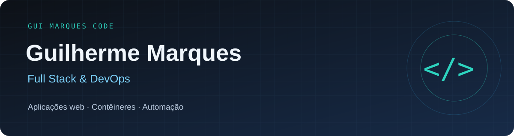

  
  

## Olá, eu sou o Gui 👋

Sou estudante de **Análise e Desenvolvimento de Sistemas na SPTech** e estagiário na **Minsait**, com foco de carreira em **desenvolvimento full stack e DevOps**. Gosto de entender como uma aplicação funciona por completo: da interface ao ambiente em que ela roda.

- 💻 Atuo com desenvolvimento full stack, utilizando **C#, MVC, RabbitMQ, Docker e pipelines de CI/CD**.
- 🚀 Liderei uma **migração de serviços para Docker e Kubernetes**, colocada em produção, com ganhos em versionamento e balanceamento de carga.
- 🐧 Tenho experiência com **Linux e sustentação de ambientes corporativos**.
- 🎓 Conclusão prevista da graduação em **junho de 2027**.
- 🌎 **Português nativo · Inglês intermediário**.

## Tecnologias 🛠️

### Desenvolvimento web
       

### Infraestrutura e automação
       

### Dados e mensageria
   

<b>Minha experiência com as tecnologias</b>

**Maior domínio:** HTML, CSS, JavaScript, Tailwind CSS, Docker, Linux, MySQL, SQL Server e n8n.

**Intermediário:** Java, Spring Boot, React, Python, AWS, Git, CI/CD, RabbitMQ e Rancher.

**Conhecimentos básicos, em evolução:** C#, .NET, Kubernetes, PHP e Node.js. Já aplico parte dessas tecnologias em projetos acadêmicos e profissionais.

## Da ideia à produção 🚀

Na Minsait, **liderei a migração de serviços executados de forma tradicional para contêineres Docker, com execução em Kubernetes**. O projeto entrou em produção e trouxe ganhos expressivos em **versionamento e balanceamento de carga**.

Essa experiência reforçou meu interesse em aproximar desenvolvimento e infraestrutura, acompanhando as soluções até sua operação.

## Projetos em destaque 📌

### 🎵 [Oceans](https://github.com/GuiMarquesCode/Oceans)
Projeto individual da faculdade: uma rede social para compartilhar sentimentos e histórias ligados à música. Inclui feed, postagens, dashboards, estatísticas e integração com a API Deezer.

`Node.js` `JavaScript` `HTML` `CSS` `MySQL` `Chart.js` `API Deezer`

### 🔥 [Phoenix Eye](https://github.com/Lucas-tdo/Phoenix-Eye)
Projeto acadêmico em equipe voltado ao monitoramento de áreas de proteção ambiental. Integra sensores, dashboards, gráficos e mapas com avisos de temperatura para apoiar a identificação de condições de risco.

`Node.js` `Express` `MySQL` `Arduino` `SerialPort` `Docker`

### 💰 [Save Your Money](https://github.com/GuiMarquesCode/Save-Your-Money)
TCC da Etec voltado à educação e organização financeira. Reúne acompanhamento de gastos, dívidas e metas, módulos educativos, conversão de moedas e cotações.

`PHP` `MariaDB` `XAMPP`

## Formação 🎓

**SPTech — Análise e Desenvolvimento de Sistemas**  
2025 – junho de 2027 (previsão)

**Etec — Desenvolvimento de Sistemas**  
2023 – 2024

## Um commit de cada vez 🐍

<picture>
  <source media="(prefers-color-scheme: dark)" srcset="https://raw.githubusercontent.com/GuiMarquesCode/GuiMarquesCode/output/github-snake-dark.svg" />
  <source media="(prefers-color-scheme: light)" srcset="https://raw.githubusercontent.com/GuiMarquesCode/GuiMarquesCode/output/github-snake.svg" />
  
</picture>

Curiosidade para aprender. Iniciativa para construir. Colaboração para evoluir.

